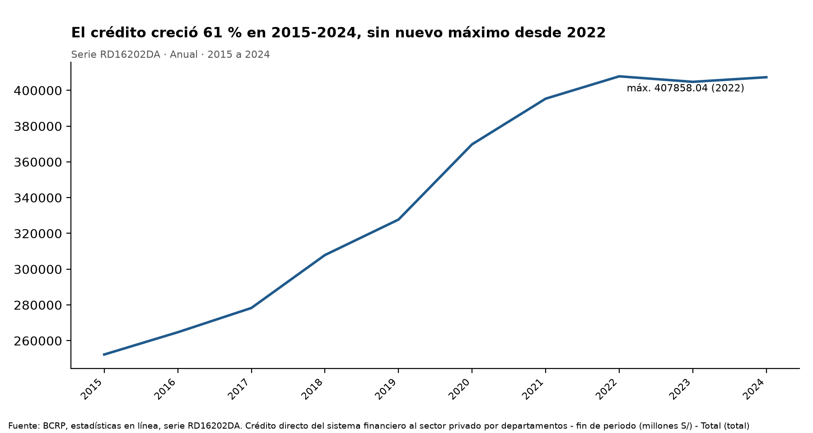
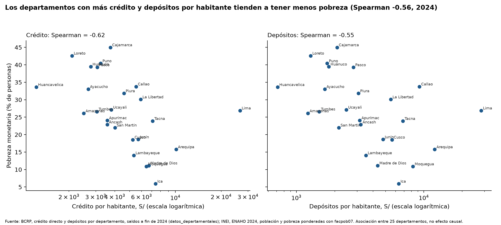
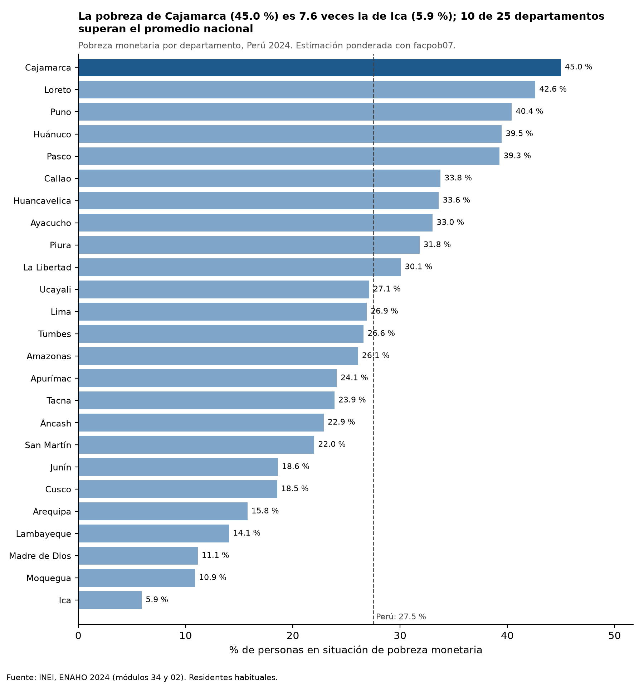
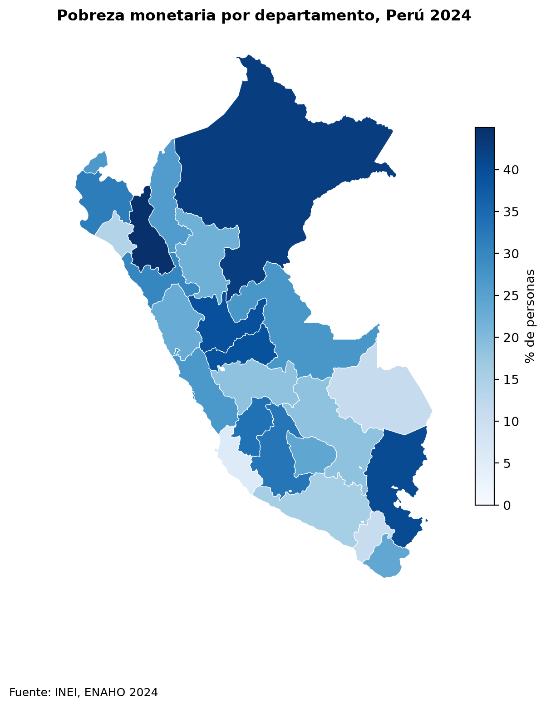

# Profundización financiera y pobreza departamental en el Perú, 2024

## Plan de análisis (escrito antes de ejecutar)

- **Fuentes:** BCRP (servidor MCP `bcrp`): crédito directo y depósitos del sistema financiero por departamento, saldos a fin de 2024, más la serie nacional RD16202DA (2015-2024). INEI: ENAHO 2024, módulos 34 (sumaria) y 02 (miembros del hogar).
- **Indicadores:** crédito por habitante y depósitos por habitante (S/), y su suma como profundización por habitante; tasa de pobreza monetaria (% de personas) por departamento.
- **Herramientas:** `buscar_series`, `datos_departamentales`, `resumen` y `graficar_serie` (MCP); las skills `limpiando-enaho`, `mapeando-enaho` y `cruzando-bcrp-enaho`; correlación de Spearman con 25 departamentos y con 23 (sin Lima ni Callao).
- **Validación:** contrastar la pobreza nacional con la cifra oficial del INEI (27.6 %) y el mapa con la referencia de la Sesión 16; verificar las cifras clave con `informes/verificar_cifras.py`, que sigue otra ruta de código.

---

## 1. Pregunta de investigación

- **Tema:** relación entre el desarrollo del sistema financiero regional y la pobreza monetaria.
- **Pregunta:** ¿la profundización financiera departamental, entendida como créditos y depósitos, se asocia con menores niveles de pobreza en 2024?
- **Objetivo:** medir el sentido y la fuerza de la asociación entre el crédito y los depósitos por habitante y la tasa de pobreza monetaria de los departamentos del Perú.
- **Delimitación:** 25 departamentos (Lima y Callao por separado), año 2024, con saldos a fin de periodo. El análisis es transversal y descriptivo: mide asociaciones, no efectos causales.

## 2. Fuentes y metodología

**Datos.**
- *BCRP:* crédito directo del sistema financiero al sector privado por departamento (series anuales "(total)", moneda nacional más extranjera, de RD16127DA a RD16199DA) y depósitos en el sistema financiero por departamento (de RD16205DA a RD16277DA), en millones de S/ de 2024. Los traje con `datos_departamentales` y quedaron en `salidas/bcrp_credito_2024.csv` y `salidas/bcrp_depositos_2024.csv`. Para el contexto temporal usé el total nacional RD16202DA, 2015-2024.
- *ENAHO 2024 (INEI):* módulos 34 y 02 (`datos/966-Modulo34.zip`, `datos/966-Modulo02.zip`), limpiados y unidos en una base de 108,664 residentes habituales (`salidas/personas_2024.parquet`, `salidas/validacion.txt`).

**Cómo se mide la profundización.** Para cada departamento:
- crédito por habitante = crédito (millones de S/) × 10⁶ / población;
- depósitos por habitante = depósitos (millones de S/) × 10⁶ / población;
- profundización por habitante = la suma de ambos.

La población es la suma del factor de expansión de personas `facpob07` de la ENAHO. Los BCRP y la ENAHO se unen por el código INEI de departamento (2 dígitos, igual a `ubigeo[:2]`), nunca por nombre.

**Ponderación.** La pobreza departamental es la suma de `facpob07` de las personas pobres (pobreza ≤ 2) dividida entre la suma de `facpob07` del departamento. No se cuentan filas sin ponderar. Para comparar con las cifras oficiales, la validación usa además el método de hogares: `factor07 × mieperho`.

**Correlación de Spearman.** Mide la asociación por rangos: si los departamentos que ordenan más alto en profundización ordenan más bajo en pobreza. Es robusta a valores extremos como Lima. La calculé con los 25 departamentos y con 23, sin Lima ni Callao. Como referencia, el script también reporta la correlación de Pearson sobre el logaritmo del indicador.

## 3. Resultados

**Hallazgo 1. El crédito creció fuerte en la última década, pero está muy concentrado en Lima.**
- El crédito directo total pasó de S/ 252,256 millones en 2015 a S/ 407,352 millones en 2024, un aumento de 61.5 %. El máximo del periodo fue de S/ 407,858 millones, en 2022; en 2024 el saldo seguía apenas por debajo. *Fuente: BCRP, RD16202DA, 2015-2024, herramienta `resumen`.*
- En 2024, Lima registró S/ 298,472 millones de crédito (RD16169DA, 2024), es decir, el 73.3 % del total de los 25 departamentos. *Fuente: `salidas/bcrp_credito_2024.csv` y `informes/verificacion_independiente.csv`.*
- Los depósitos sumaron S/ 413,174 millones en 2024, y Lima concentró S/ 317,144 millones (RD16247DA, 2024). *Fuente: `salidas/bcrp_depositos_2024.csv`.*

**Hallazgo 2. La pobreza departamental varía mucho entre departamentos, y las estimaciones coinciden con las fuentes oficiales.**
- La pobreza monetaria nacional de 2024 es 27.58 % con el método de hogares y 27.53 % con personas ponderadas por `facpob07`. Ambas quedan dentro de ±0.1 puntos del 27.6 % oficial del INEI. *Fuente: `salidas/validacion.txt` (RESULTADO: OK).*
- Las tasas más altas son las de Cajamarca (45.0 %), Loreto (42.6 %) y Puno (40.4 %); las más bajas, las de Ica (5.9 %), Moquegua (10.9 %) y Madre de Dios (11.1 %). *Fuente: `salidas/comparacion_mapa.csv`, columna `mapa_personas`.*
- Los 25 departamentos coinciden con la referencia de la Sesión 16 dentro de ±0.1 puntos; la diferencia máxima es de 0.049 puntos (Amazonas). *Fuente: `salidas/comparacion_mapa.csv`.*

**Hallazgo 3. A más profundización financiera por habitante, menos pobreza: la asociación es moderada con los 25 departamentos y se vuelve más fuerte sin Lima ni Callao.**

| Indicador por habitante | Spearman, 25 departamentos | Spearman, 23 departamentos (sin Lima ni Callao) |
|---|---|---|
| Crédito | −0.618 | −0.730 |
| Depósitos | −0.552 | −0.726 |
| Crédito + depósitos | −0.565 | −0.741 |

*Fuente: `salidas/correlaciones.csv`.*

La verificación independiente, que usa la API del BCRP directa y el método de hogares, da −0.604 (crédito, 25 departamentos), −0.562 (profundización, 25) y −0.741 (profundización, 23). Son prácticamente las mismas cifras. *Fuente: `informes/verificacion_independiente.csv`.*

**Hallazgo 4. Los extremos muestran la tendencia, pero también excepciones importantes.**
- Huancavelica tiene la menor profundización: S/ 1,221 de crédito y S/ 711 de depósitos por habitante, con 33.6 % de pobreza. Loreto tiene S/ 2,095 y S/ 1,293, con 42.6 % de pobreza.
- Ica (S/ 7,414 de crédito por habitante, 5.9 % de pobreza) y Moquegua (S/ 6,454; 10.9 %) combinan una profundización alta con pobreza baja.
- Hay excepciones. Lima tiene la mayor profundización (S/ 26,570 de crédito y S/ 28,233 de depósitos por habitante), pero su pobreza (26.9 %) está cerca del promedio nacional. Callao ocupa el tercer lugar en profundización y tiene 33.8 % de pobreza.

*Fuente: `salidas/cruce_departamental.csv`.*

## 4. Visualizaciones



*Lectura:* el saldo de crédito al sector privado creció de forma continua entre 2015 y 2022 y luego se mantuvo casi plano hasta 2024, sin superar el máximo de 2022 (BCRP, RD16202DA, 2015-2024).



*Lectura:* los departamentos con más crédito y más depósitos por habitante (a la derecha, en escala logarítmica) tienden a estar más abajo en pobreza. Lima y Callao se apartan del patrón: tienen mucha profundización y una pobreza intermedia o alta (`salidas/correlaciones.csv`).



*Lectura:* barras ponderadas con `facpob07` y la línea del promedio nacional (27.5 %). Diez departamentos superan el promedio y la tasa de Cajamarca (45.0 %) es 7.6 veces la de Ica (5.9 %) (skill `graficando-enaho`, `salidas/indicadores.csv`). *Gráfico agregado después de la ejecución del agente con `uv run .claude/skills/graficando-enaho/scripts/graficar.py --por departamento`, para incluir un gráfico solo de la ENAHO.*



*Lectura:* la pobreza se concentra en la sierra norte y central (Cajamarca, Huánuco, Pasco, Puno) y en la Amazonía norte (Loreto). La costa sur (Ica, Moquegua) y Madre de Dios tienen las tasas más bajas (`salidas/comparacion_mapa.csv`).

## 5. Interpretación

1. **El patrón general es claro y negativo.** Los departamentos con más crédito y más depósitos por habitante tienden a tener menos pobreza monetaria. Spearman está entre −0.55 y −0.62 con los 25 departamentos, y el sentido de la asociación es el mismo para el crédito, para los depósitos y para su suma.
2. **Lima y Callao debilitan la asociación, no la generan.** Al excluirlos, la correlación sube en magnitud hasta −0.73 / −0.74. El registro financiero de la capital refleja en gran medida la actividad de empresas con sede en Lima que operan en todo el país. Por eso su profundización por habitante es muy alta frente a una pobreza de nivel medio, y Callao, con una pobreza de 33.8 %, se comporta igual. Entre los departamentos del interior, en cambio, la relación es más nítida.
3. **El crédito y los depósitos se mueven juntos.** Las correlaciones son muy parecidas, lo que sugiere que ambos capturan la misma dimensión: el tamaño de la economía formal local y del ingreso, más que dos canales distintos.
4. **La profundización no basta para explicar la pobreza.** Hay departamentos con profundización parecida y niveles de pobreza muy distintos; por ejemplo, Huancavelica (33.6 %) frente a Amazonas (26.1 %), ambos en el extremo de menor profundización. Hay otros factores (estructura productiva, ruralidad, servicios) que este análisis no controla.

En resumen: **sí, en 2024 una mayor profundización financiera departamental se asocia con menores niveles de pobreza**. La asociación es moderada con los 25 departamentos y fuerte sin Lima ni Callao. Es una asociación, no una prueba de que el crédito o los depósitos reduzcan la pobreza.

## 6. Limitaciones

- **Solo 25 observaciones y un año.** Es un corte transversal de 2024: no permite ver la dinámica en el tiempo, y con n = 25 cada departamento pesa mucho en la correlación.
- **El crédito se registra donde se otorga.** El BCRP asigna el crédito y los depósitos al departamento de la agencia o la sede, no al lugar donde se usan. Lima concentra el registro de empresas con sede en la capital (73.3 % del crédito en 2024), lo que infla su profundización y la del Callao.
- **Falacia ecológica.** La asociación es entre departamentos. No implica que las personas u hogares con crédito sean menos pobres.
- **Posible causalidad inversa.** Los departamentos con más ingresos y menos pobreza pueden atraer más crédito y generar más depósitos; la dirección de la relación no puede identificarse con estos datos.
- **Variables omitidas.** No se controla por PBI per cápita, urbanización, educación ni actividad minera, que pueden influir a la vez en la profundización y en la pobreza.
- **Asociaciones, no causas.** Ningún resultado de este informe debe leerse como un efecto causal.
- **Medición.** La población del denominador es la expandida por la ENAHO (`facpob07`), no la proyección oficial del INEI; las cifras por habitante pueden diferir algo de otras fuentes. La ENAHO tiene error muestral, mayor en departamentos pequeños como Madre de Dios o Moquegua.

No hubo fallas de herramientas: las cuatro herramientas MCP y las tres skills devolvieron datos completos (25 de 25 departamentos), y todas las validaciones dieron OK.

## 7. Reproducibilidad

Comandos ejecutados desde `tarea_4/`:

```bash
# 1. Limpieza y validación de la ENAHO 2024
uv run .claude/skills/limpiando-enaho/scripts/limpiar.py --anio 2024
# 2. Mapa departamental y comparación con la Sesión 16
uv run .claude/skills/mapeando-enaho/scripts/mapear.py
# 3. Cruce BCRP-ENAHO, correlaciones y dispersión
uv run .claude/skills/cruzando-bcrp-enaho/scripts/cruzar.py --anio 2024
# 4. Verificación independiente (API del BCRP directa + sumaria)
uv run informes/verificar_cifras.py
```

Llamadas MCP (servidor `mcp/server.py`):
- `buscar_series("credito directo departamentos", "Anual")` y `buscar_series("depositos sistema financiero departamentos", "Anual")`
- `datos_departamentales("credito directo departamentos", 2024, "credito")` y `datos_departamentales("depositos sistema financiero departamentos", 2024, "depositos")`
- `resumen("RD16202DA", "2015", "2024")` y `graficar_serie("RD16202DA", "2015", "2024", titulo=...)`

Códigos de series del BCRP:
- Crédito por departamento: de RD16127DA a RD16199DA, de 3 en 3, en el orden INEI del 01 al 25.
- Depósitos por departamento: de RD16205DA a RD16277DA, con el mismo orden.
- Total nacional de crédito: RD16202DA.

Archivos:
- *Entradas:* `datos/966-Modulo34.zip`, `datos/966-Modulo02.zip`, `datos/peru_departamental_simple.geojson`.
- *Salidas:* `salidas/bcrp_credito_2024.csv`, `salidas/bcrp_depositos_2024.csv`, `salidas/personas_2024.parquet`, `salidas/validacion.txt`, `salidas/indicadores.csv`, `salidas/comparacion_mapa.csv`, `salidas/cruce_departamental.csv`, `salidas/correlaciones.csv`, `informes/verificacion_independiente.csv`.
- *Figuras:* `figuras/bcrp_RD16202DA_2015_2024.png`, `figuras/dispersion_profundizacion_pobreza.png`, `mapas/pobreza_departamento.png`.

## 8. Verificación de cifras

Después de la ejecución del agente, se comprobaron afirmaciones del informe por una vía independiente con `uv run informes/verificar_cifras.py`. Ese script no usa el servidor MCP ni las skills: llama directo a la API del BCRP con los códigos de serie y lee la sumaria directo del zip del INEI (`factor07 × mieperho`). Los resultados están en [`verificacion_independiente.csv`](verificacion_independiente.csv).

| # | Afirmación del informe | Valor del informe | Valor verificado | Fuente o procedimiento | ¿Coincide? | Diferencia |
|---|---|---|---|---|---|---|
| 1 | Crédito total 2024 (BCRP) | S/ 407,352 millones | S/ 407,351.7 millones, tanto en la suma de los 25 códigos como en la serie Total RD16202DA | API BCRP directa, dos vías | Sí | 0 |
| 2 | Crédito de Lima 2024 y su participación | S/ 298,472 millones; 73.3 % | S/ 298,472.3 millones; 73.3 % | API BCRP directa, RD16169DA | Sí | 0 |
| 3 | Depósitos totales 2024 | S/ 413,174 millones | S/ 413,174.3 millones | API BCRP directa, de RD16205DA a RD16277DA | Sí | 0 |
| 4 | Pobreza nacional 2024 (ENAHO) | 27.58 % (hogares) | 27.58 %; 27.6 % oficial del INEI | Sumaria del zip, `factor07 × mieperho` | Sí | −0.02 frente al INEI (redondeo) |
| 5 | Spearman profundización–pobreza, 25 departamentos | −0.565 | −0.562 | API BCRP + población y pobreza por hogares | Sí | 0.003 (ponderador) |
| 6 | Spearman profundización–pobreza, sin Lima ni Callao | −0.741 | −0.741 | Ídem | Sí | 0 |
| 7 | Crédito por habitante de Lima | S/ 26,570 | S/ 26,460.5 | Ídem, población `factor07 × mieperho` | Sí, con nota | 0.4 % por el ponderador |
| 8 | Crédito por habitante de Huancavelica | S/ 1,221 | S/ 1,180.2 | Ídem | Sí, con nota | 3.4 % por el ponderador |

**Diferencias observadas.** Las cifras por habitante dependen de la población del denominador. La skill usa `facpob07`, la suma de los factores de las personas residentes. La verificación usa `factor07 × mieperho`, la población por hogares. En Huancavelica la diferencia de población entre los dos métodos es de alrededor de 3 %, y eso explica la brecha. El signo y la magnitud de las correlaciones no cambian.

**Manejo de errores.** En otra ejecución se le pidieron al agente datos inexistentes: la inflación de 1850, la ENAHO 2019 y una serie con el código ZZ12345. El agente informó cada error de la herramienta y no inventó cifras. Para la serie inexistente respondió *"No existe el código de serie 'ZZ12345'"*, y para la ENAHO 2019 explicó que la skill solo valida 2024. Registro en [`evidencias_ia/integracion/manejo_errores.jsonl`](../evidencias_ia/integracion/manejo_errores.jsonl).

## Registro de herramientas usadas

| Herramienta | Tipo | Para qué se usó |
|---|---|---|
| `buscar_series` | MCP bcrp | Ubicar los grupos de series anuales de crédito directo y de depósitos por departamento |
| `datos_departamentales` | MCP bcrp | Traer los 25 departamentos de 2024 de crédito (etiqueta "credito") y de depósitos (etiqueta "depositos") y guardarlos en salidas/ |
| `resumen` | MCP bcrp | Calcular el cambio, la variación porcentual y el máximo del crédito total RD16202DA, 2015-2024 |
| `graficar_serie` | MCP bcrp | Graficar RD16202DA 2015-2024 con un título analítico (se regeneró una vez con un título más corto porque el primero se cortaba) |
| `limpiando-enaho` | Skill | Limpiar y unir los módulos 34 y 02 de la ENAHO 2024, validar contra el INEI (27.6 %) y generar la base de personas |
| `mapeando-enaho` | Skill | Hacer el mapa de pobreza departamental y compararlo con la referencia de la Sesión 16 (25/25 dentro de ±0.1) |
| `cruzando-bcrp-enaho` | Skill | Calcular el crédito y los depósitos por habitante, las correlaciones de Spearman (25 y 23 departamentos) y el gráfico de dispersión |
| `informes/verificar_cifras.py` | Script del proyecto | Verificar las cifras clave por una ruta independiente del MCP y de las skills |
